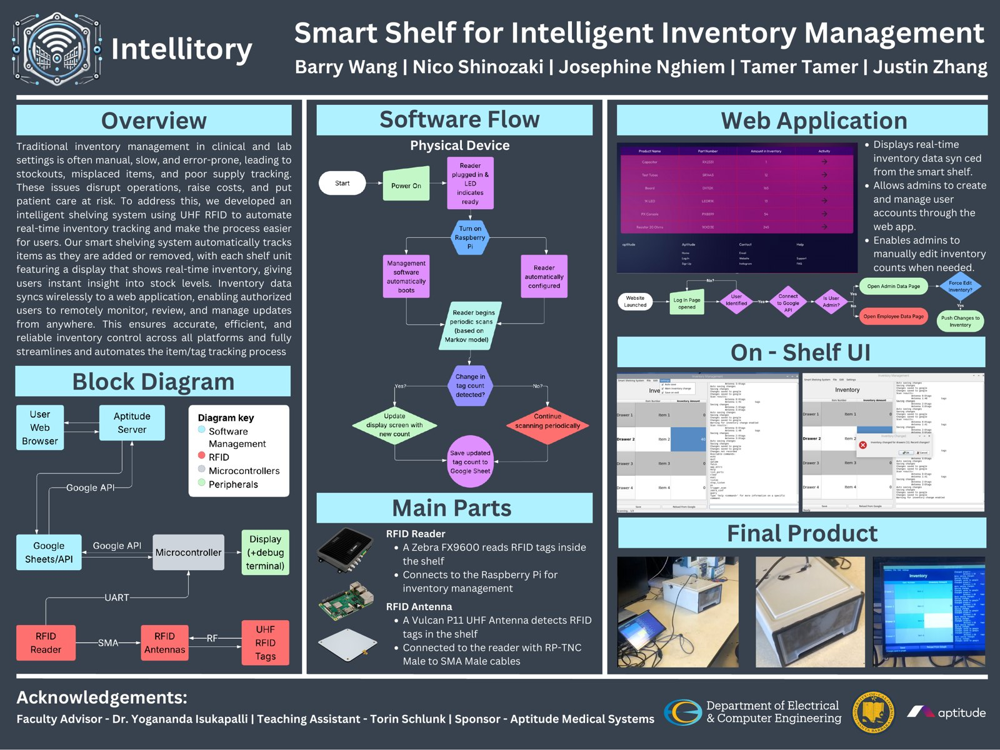

# Intellitory — Smart Shelf for Intelligent Inventory Management

**UC Santa Barbara ECE senior capstone, built for Aptitude Medical Systems**


[**▶ Watch the demo**](https://drive.google.com/file/d/105lcCWPpjfRcBupliVbanH7hz7W0ZH2X/view) · [Project report (PDF)](Report.pdf) · [Poster (PDF)](Poster.pdf) · [Source code](https://github.com/nicoshinozaki/Smart-Shelving-System)



## The problem

Aptitude tracked lab and clinical supplies by having staff scan a QR code every time they took something out of a drawer. People forgot, counts drifted, and items ran out without warning.

## What we built

A shelf that counts its own inventory. Every item carries a passive UHF RFID tag. Antennas inside each drawer read the tags, a Raspberry Pi works out what changed, and the new counts sync to the cloud automatically. Staff see live counts on a touchscreen at the shelf, and admins can check and manage stock remotely from a web dashboard.

## How it works

```
 UHF RFID tags ──RF──► Vulcan P11 antennas ──SMA──► Zebra FX9600 reader
 (on each item)        (inside shielded drawers)         │ UART
                                                         ▼
                                   Raspberry Pi 4 · Python management app
                                   ├─ Selenium script configures the reader on boot
                                   ├─ polls tag reads at a fixed interval
                                   ├─ filters noise (none / sliding window / HMM-Viterbi)
                                   └─ PyQt6 touchscreen UI + debug console
                                                         │ Google API
                                                         ▼
                                   Google Sheets  ◄──►  React web dashboard
                                                         (login, live stock, admin edits)
```

**Filtering noisy RFID reads.** Tags occasionally drop out of a read cycle, so raw reads overcount and undercount. The software lets you pick how to smooth them:

| Mode | How it works | Trade-off |
|---|---|---|
| No filtering | Latest read is the truth | Fastest, least accurate |
| Sliding window | A tag must appear in most recent intervals | Balanced |
| HMM + Viterbi | Predicts true tag state from history and adapts over time | Most accurate, needs warm-up |

**Choosing the reader.** We benchmarked two RFID readers before committing:

| Tags in drawer | Yanzeo SR682 | Zebra FX9600 |
|---|---|---|
| 30 | 100% in 8 s | 100% in < 2.5 s |
| 40 | 98% in 30 s | 100% in < 2.5 s |
| 96 | 63% in 60 s | 98% in 2.5 s |

## My role

I led the **software and dashboard side**: the React/TypeScript web app and Node.js backend that show live inventory and let admins manage accounts and correct counts, plus **Selenium automation** that configures the RFID scanner on startup so the shelf comes up without manual setup. I also helped integrate the RFID and weight-sensor hardware, and met with the client to turn their workflow into requirements.

## Team

Barry Wang · Nico Shinozaki · Josephine Nghiem · **Tamer Tamer** · Justin Zhang

Faculty advisor: Dr. Yogananda Isukapalli · TA: Torin Schlunk · Sponsor: Aptitude Medical Systems
